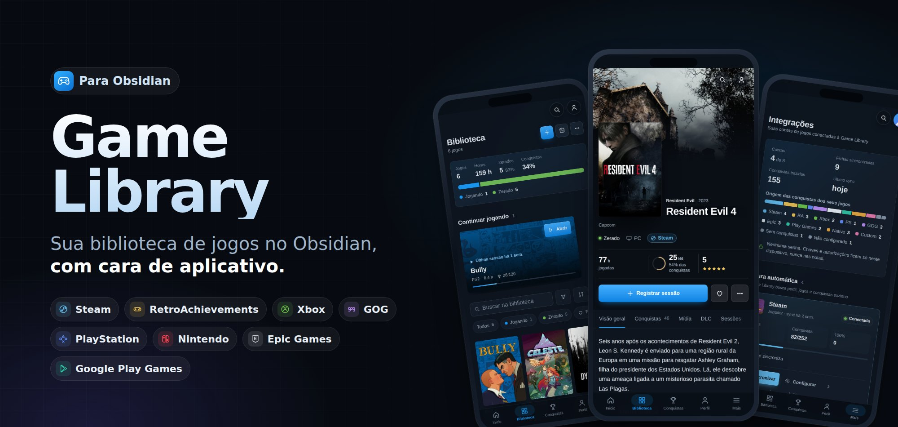
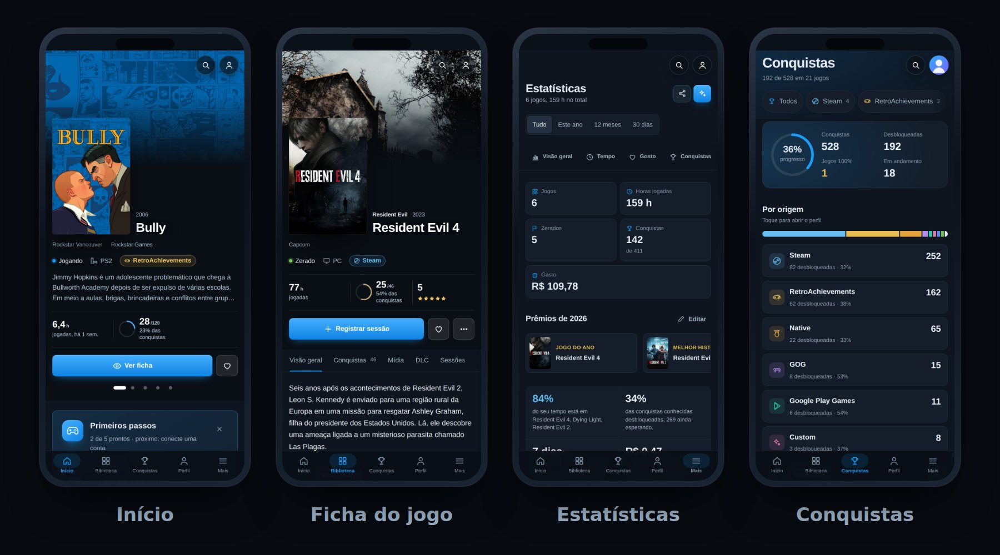
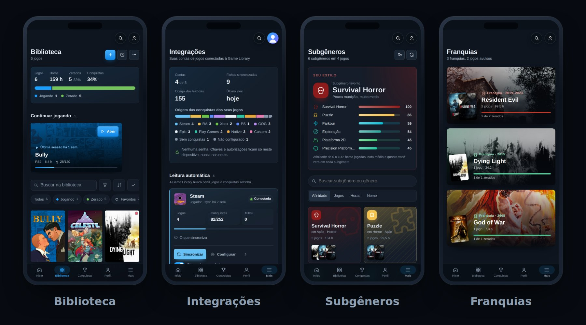
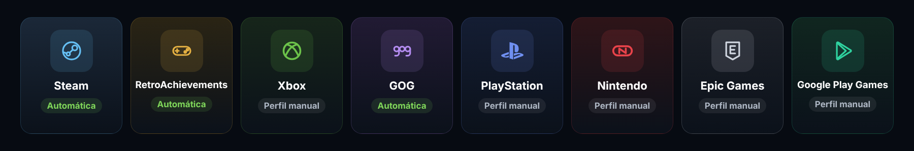
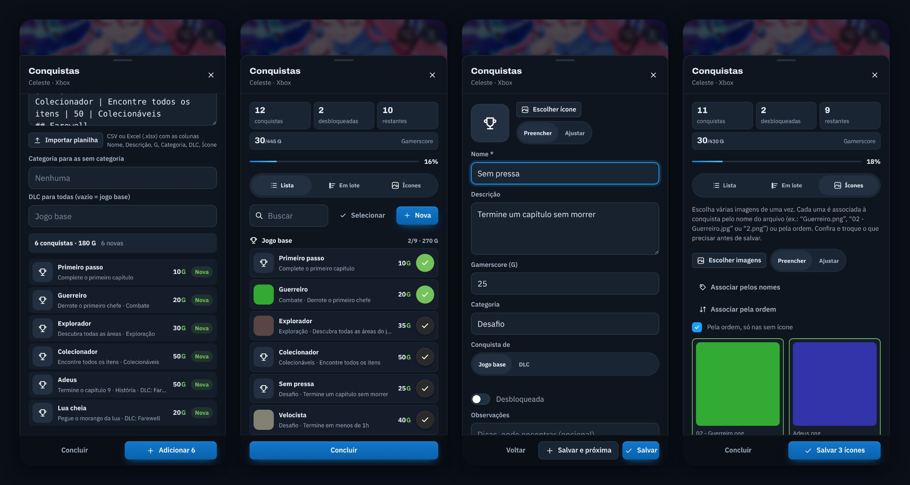
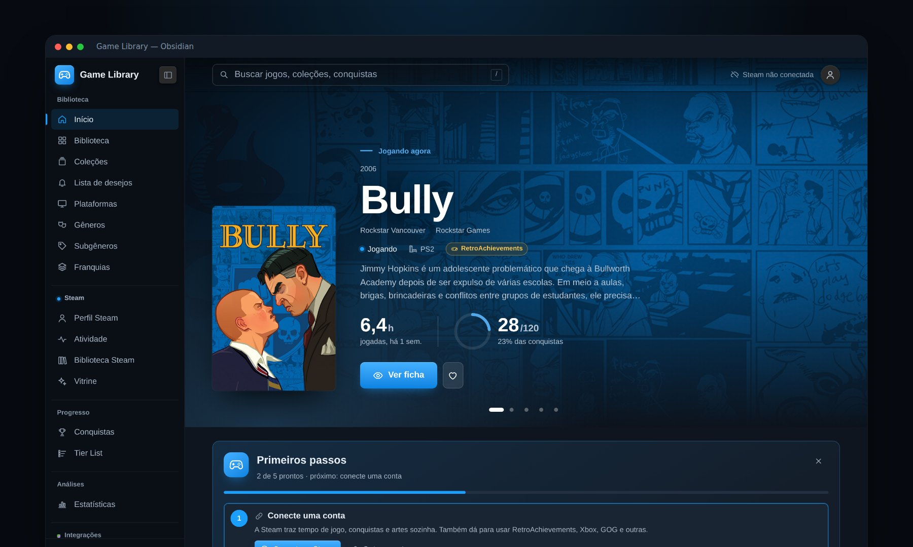

<p align="center">
  
</p>

<p align="center">
  <a href="../../releases/latest"></a>
  
  
  
</p>

<p align="center">
  <a href="../../actions/workflows/tests.yml"></a>
</p>

<p align="center">
  <b>Game Library</b> é um vault do <a href="https://obsidian.md">Obsidian</a> que transforma notas Markdown numa biblioteca de jogos com cara de aplicativo:<br>
  <b>capas, conquistas, estatísticas e sincronização</b>, em arquivos que continuam seus.<br>
  <sub>Steam · RetroAchievements · Xbox · GOG · PlayStation · Nintendo · Epic Games · Google Play Games</sub>
</p>

<p align="center">
  <a href="#-destaques">Destaques</a> ·
  <a href="#-integrações">Integrações</a> ·
  <a href="#-xbox-cadastro-manual-e-conquistas">Xbox</a> ·
  <a href="#%EF%B8%8F-tecnologias">Tecnologias</a> ·
  <a href="#-instalação">Instalação</a> ·
  <a href="#-como-o-vault-é-organizado">Organização</a> ·
  <a href="DOCUMENTACAO.md">Documentação</a> ·
  <a href="CHANGELOG.md">Changelog</a>
</p>

<br>

<p align="center">
  
</p>

## ✨ Destaques

<table>
  <tr>
    <td width="33%" valign="top">🎮 <b>Ficha de cada jogo</b><br><sub>Arte, capa, logo, tempo, nota, sessões, DLC, mídia, análise com prós e contras.</sub></td>
    <td width="33%" valign="top">🏆 <b>Conquistas num lugar só</b><br><sub>Um hub com uma aba por origem, raridade, mais raras e próximos objetivos.</sub></td>
    <td width="33%" valign="top">📊 <b>Estatísticas</b><br><sub>Por período: tempo, gosto, conquistas e dinheiro, com cartão para compartilhar.</sub></td>
  </tr>
  <tr>
    <td valign="top">📚 <b>Biblioteca</b><br><sub>Filtros, visões em grade e lista, coleções inteligentes, menu rápido e ações em lote.</sub></td>
    <td valign="top">🗂️ <b>Plataformas, gêneros, subgêneros e franquias</b><br><sub>Cada um com página própria, cor e ícone.</sub></td>
    <td valign="top">🔗 <b>Integrações</b><br><sub>Todas as contas numa tela, sem senha, com as chaves só no seu aparelho.</sub></td>
  </tr>
  <tr>
    <td valign="top">🏠 <b>Início</b><br><sub>Jogando agora, sua semana, metas, memórias e o que jogar a seguir.</sub></td>
    <td valign="top">🃏 <b>Cartões para compartilhar</b><br><sub>Jogo, perfil e estatísticas em PNG, gerados no próprio aparelho.</sub></td>
    <td valign="top">📱 <b>Feito para o celular</b><br><sub>Barra inferior, gestos, tema claro e escuro, e também no computador.</sub></td>
  </tr>
  <tr>
    <td valign="top">🛒 <b>Lista de desejos</b><br><sub>Preço atual, menor preço já visto, histórico, preço-alvo e importação da lista da Steam.</sub></td>
    <td valign="top">🧭 <b>Primeiros passos</b><br><sub>Um assistente leva do vault vazio à biblioteca pronta em cinco passos.</sub></td>
    <td valign="top">✅ <b>Testado a cada versão</b><br><sub>Todas as telas abertas no celular e no computador antes de publicar.</sub></td>
  </tr>
</table>

<p align="center">
  
</p>

## 🔗 Integrações

<p align="center">
  
</p>

| Plataforma | Como funciona | O que traz |
|---|---|---|
| **Steam** | Perfil público da Steam Community, sem login | Perfil, tempo de jogo, conquistas com raridade, artes da loja |
| **RetroAchievements** | Web API oficial, com usuário e Web API Key | Perfil, pontos, jogos, prêmios e conquistas |
| **Xbox** | Perfil manual, sem login nem rede | Jogos e conquistas cadastrados por você: em lote, por planilha CSV/Excel ou uma a uma, com ícones em lote |
| **GOG** | Perfil público, sem login | Jogos, tempo e % de conquistas |
| **PlayStation · Nintendo · Epic · Google Play** | Perfil manual, sem rede | Importação por lista e registro de conquistas, troféus ou objetivos |

> [!NOTE]
> A Game Library não pede senha nem usa cookies ou tokens de sessão. Chaves e autorizações ficam só no seu dispositivo, fora das notas. Quando uma plataforma não oferece um meio legítimo de leitura, o perfil é manual. Os detalhes estão em [Integrações de plataformas](DOCUMENTACAO.md#integrações-de-plataformas-versão-3335).

## 🟢 Xbox: cadastro manual e conquistas

<p align="center">
  
</p>
<p align="center"><sub>Capturas reais do harness de testes do repositório (Chromium, 410 px), com dados de exemplo.</sub></p>

As conquistas do Xbox são **100% manuais**: nada de API, site de terceiros ou internet. Você controla nomes, descrições, G, ícones e progresso, e o cadastro é feito para ser rápido:

- **Em lote:** cole uma conquista por linha (`Nome | Descrição | G | Categoria | DLC`), com seções `## DLC`, ou importe uma planilha **CSV ou Excel**. As colunas são reconhecidas e há prévia antes de confirmar.
- **Uma a uma:** formulário com **Salvar e próxima** (ou Enter) e **Duplicar**.
- **Ícones em lote:** escolha várias imagens de uma vez; cada uma é associada à conquista pelo nome do arquivo ou pela ordem, recortada em quadrado e salva em WebP no vault.
- **Seleção em massa:** desbloquear, bloquear, mudar categoria ou DLC e excluir várias de uma vez.
- **Na ficha:** total, desbloqueadas, restantes, G conquistado/total e porcentagem, com jogo base e DLCs separados.
- **Seus dados:** backup automático antes de excluir ou atualizar, restauração sem apagar nada e exportação para CSV.

Detalhes em [Xbox: conquistas 100% manuais](DOCUMENTACAO.md#xbox-conquistas-100-manuais-374).

## 💻 No computador

<p align="center">
  
</p>

<p align="center">
  
  &nbsp;
  
</p>
<p align="center"><sub>Cartões para compartilhar, gerados no próprio aparelho.</sub></p>

## 🛠️ Tecnologias

| | |
|---|---|
| **[Obsidian](https://obsidian.md)** | O aplicativo, no computador e no celular (Android e iOS) |
| **[Dataview](https://github.com/blacksmithgu/obsidian-dataview)** | Lê o frontmatter das notas; cada tela é um bloco `dataviewjs` |
| **[CustomJS](https://github.com/saml-dev/obsidian-custom-js)** | Carrega o código em `Scripts/` (JavaScript puro, sem build) |
| **CSS snippet** | Todo o visual em `steamvault.css`, com tema claro e escuro e ajustes pelo Style Settings |
| **Playwright + Chromium** | Testes automáticos no GitHub Actions: todas as telas no celular e no computador, em português e inglês |

Sem servidor, sem conta e sem banco de dados: tudo são arquivos Markdown e imagens dentro do vault.

## 🚀 Instalação

1. Baixe o `Game_Library_X.Y.Z.zip` da [versão mais recente](../../releases/latest), descompacte e abra a pasta `Game_Library` como vault no [Obsidian](https://obsidian.md).
2. Quando o Obsidian perguntar, confie no vault e ative os plugins da comunidade. [Dataview](https://github.com/blacksmithgu/obsidian-dataview), [CustomJS](https://github.com/saml-dev/obsidian-custom-js) e Style Settings já vêm configurados, com o visual (`steamvault.css`) ligado.
3. Abra `Dashboard/Home`.

> [!TIP]
> Na primeira vez, a Início mostra os **primeiros passos**: conectar uma conta, trazer os jogos, as capas, a sua cor e uma meta.
>
> Para conectar a Steam, abra **Integrações** e informe o link do seu perfil público. O primeiro sync traz tempo, conquistas e artes.

## 🧭 Como o vault é organizado

```text
Dashboard/      as telas (Início, Biblioteca, Conquistas, Integrações…)
Games/          uma nota por jogo, separadas por plataforma
Achievements/   uma nota por conquista
Collections/    coleções e metas
Platforms/  Genres/  Subgenres/  Franchises/   páginas de cada categoria
Assets/         capas, fundos, logos, ícones e trilhas
Scripts/        o código (CustomJS)
```

Cada jogo é uma nota Markdown com os dados no frontmatter. Dá para editar à mão, versionar e levar para onde quiser.

## 📖 Mais

- [Documentação](DOCUMENTACAO.md): campos, telas, integrações e solução de problemas.
- [Changelog](CHANGELOG.md): resumo das últimas versões.
- [Versões](../../releases): novidades e zip de cada versão.
- [Histórico completo](AUDITORIA.md): o que mudou em cada versão, com os detalhes.
- [Testes automáticos](.github/tests): como o GitHub confere cada envio, e como rodar no seu computador.

## 🔒 Segurança

Nenhuma senha, cookie ou token de sessão. A única chave usada (Web API Key do RetroAchievements) fica no armazenamento local do Obsidian neste aparelho, nunca nas notas nem no git. Cada integração fala só com os domínios oficiais dela, e links vindos da internet só abrem em `https` nos domínios esperados. Detalhes em [Segurança e privacidade](DOCUMENTACAO.md#segurança-e-privacidade).

<p align="center"><sub>Feito com Obsidian, Dataview e CustomJS. Game Library não é afiliada à Valve nem às demais plataformas citadas.</sub></p>
