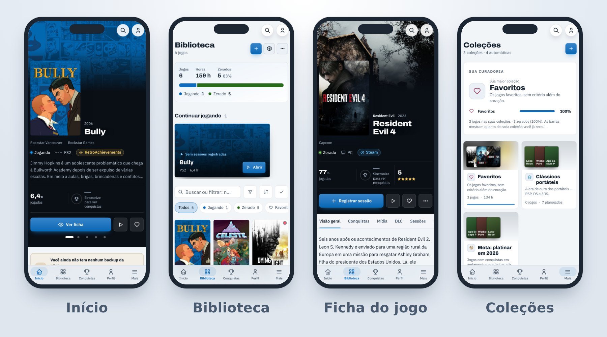
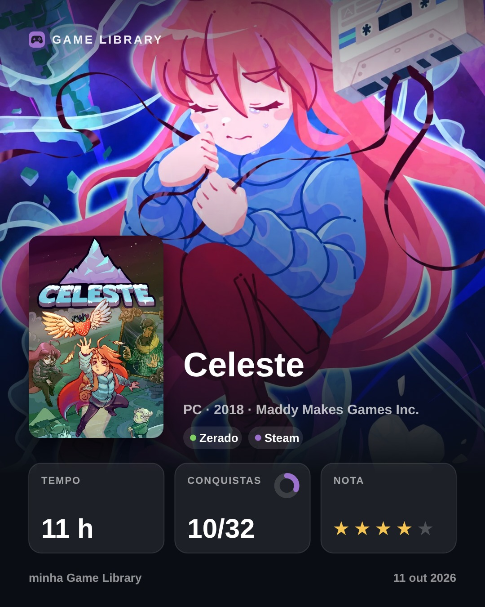
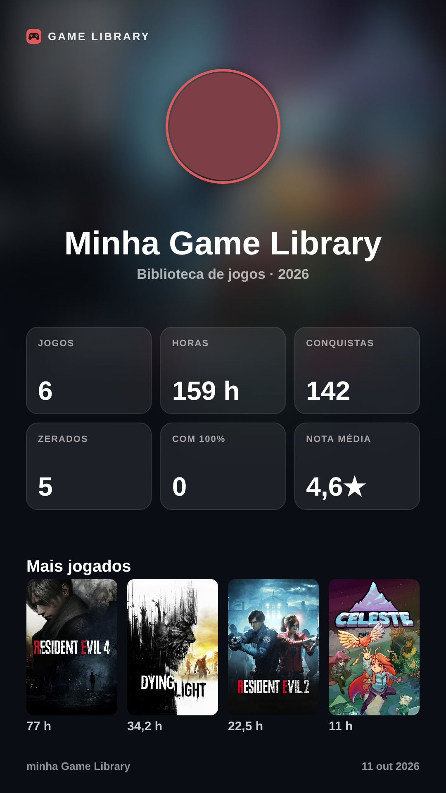

<p align="center">
  
</p>

<h1 align="center">Game Library</h1>

<p align="center">
  Uma biblioteca pessoal de videogames dentro do <a href="https://obsidian.md">Obsidian</a>, com cara de aplicativo.<br>
  Catalogue, organize e acompanhe seus jogos em notas Markdown que continuam suas.
</p>

<p align="center">
  
  
  
  
</p>

<p align="center">
  <a href="../../actions/workflows/tests.yml"></a>
</p>

<p align="center">
  <a href="#-funcionalidades">Funcionalidades</a> ·
  <a href="#-instalação">Instalação</a> ·
  <a href="#-organização-do-vault">Organização</a> ·
  <a href="#-segurança-e-privacidade">Segurança</a> ·
  <a href="#%EF%B8%8F-limitações-conhecidas">Limitações</a> ·
  <a href="#%EF%B8%8F-roadmap">Roadmap</a> ·
  <a href="DOCUMENTACAO.md">Documentação</a> ·
  <a href="CHANGELOG.md">Changelog</a>
</p>

> [!IMPORTANT]
> **V1.1 — estável.** Primeira versão estável, depois da fase de protótipo (1.0.0 a 1.0.2). Mudanças
> no formato das notas vêm sempre com migração automática e aviso no [CHANGELOG](CHANGELOG.md);
> mudanças incompatíveis só numa versão maior (2.0).

## 📱 Capturas

<p align="center">
  
</p>
<p align="center">
  
</p>
<p align="center">
  
</p>

<details>
<summary><b>No computador e cartões para compartilhar</b></summary>
<br>
<p align="center">
  
</p>
<p align="center">
  
  &nbsp;
  
</p>
</details>

<p align="center"><sub>Capturas reais do vault rodando no harness de testes (Chromium), com dados de exemplo.</sub></p>

## ✨ Funcionalidades

<table>
  <tr>
    <td width="33%" valign="top">📚 <b>Biblioteca</b><br><sub>Busca por nome, plataforma, gênero, subgênero, estúdio ou tag, com comandos (<code>status:zerado</code>, <code>nota&gt;4</code>, <code>subgenero:puzzle</code>), filtros, quatro visões, agrupamento, índice A–Z, menu rápido e ações em lote.</sub></td>
    <td width="33%" valign="top">🎮 <b>Ficha do jogo</b><br><sub>Arte, capa, logo, status, nota, tempo, sessões, zeradas, DLC, mídia, análise com prós e contras e histórico.</sub></td>
    <td width="33%" valign="top">🏠 <b>Início</b><br><sub>Jogando agora, sua semana, metas, memórias, "O que jogar agora?" e primeiros passos para um vault vazio.</sub></td>
  </tr>
  <tr>
    <td valign="top">🗂️ <b>Coleções e categorias</b><br><sub>Coleções manuais e automáticas; plataformas, gêneros, subgêneros e franquias com página, cor e ícone próprios.</sub></td>
    <td valign="top">🏆 <b>Conquistas</b><br><sub>Hub por origem, raridade, caçador de conquistas e cadastro manual (inclusive lote e planilha CSV/Excel).</sub></td>
    <td valign="top">📊 <b>Estatísticas</b><br><sub>Por período: tempo, gosto, conquistas e dinheiro, Tier List, metas e retrospectiva do ano.</sub></td>
  </tr>
  <tr>
    <td valign="top">🔗 <b>Integrações</b><br><sub>Steam, RetroAchievements e GOG automáticos; Xbox, PlayStation, Nintendo, Epic e Google Play como perfis manuais.</sub></td>
    <td valign="top">🛒 <b>Lista de desejos</b><br><sub>Preço atual, menor preço visto, histórico, preço-alvo e importação da lista pública da Steam.</sub></td>
    <td valign="top">🃏 <b>Cartões para compartilhar</b><br><sub>Jogo, perfil e ano em PNG, gerados no próprio aparelho.</sub></td>
  </tr>
  <tr>
    <td valign="top">📱 <b>Feito para o celular</b><br><sub>Barra inferior, gestos, modo aplicativo, áreas seguras do Android, de 320 px ao desktop.</sub></td>
    <td valign="top">🌗 <b>Tema claro e escuro</b><br><sub>Segue o Obsidian; ajustes de cor, densidade e capas pelo Style Settings; reduz animações quando pedido.</sub></td>
    <td valign="top">🧰 <b>Seus dados</b><br><sub>Tudo em Markdown; backup em .zip, diagnóstico do vault e reparo de nomes de arquivo.</sub></td>
  </tr>
</table>

<details>
<summary><b>Integrações em detalhe</b></summary>
<br>

| Plataforma | Como funciona | O que traz |
|---|---|---|
| **Steam** | Perfil público da Steam Community, sem login | Perfil, tempo de jogo, conquistas com raridade, artes da loja |
| **RetroAchievements** | Web API oficial, com usuário e Web API Key | Perfil, pontos, jogos, prêmios e conquistas |
| **GOG** | Perfil público, sem login | Jogos, tempo e % de conquistas |
| **Xbox** | Perfil manual, sem rede | Jogos e conquistas cadastrados por você (uma a uma, em lote ou por planilha) |
| **PlayStation · Nintendo · Epic · Google Play** | Perfil manual, sem rede | Importação por lista e registro de conquistas, troféus ou objetivos |

Quando uma plataforma não oferece um meio legítimo de leitura, o perfil é manual: a Game Library
nunca pede senha, cookie ou token de sessão. Detalhes em
[Integrações de plataformas](DOCUMENTACAO.md#integrações-de-plataformas).
</details>

## 🛠️ Tecnologias

| | |
|---|---|
| **[Obsidian](https://obsidian.md)** | O aplicativo — Android, desktop e iOS |
| **[Dataview](https://github.com/blacksmithgu/obsidian-dataview)** | Lê o frontmatter das notas; cada tela é um bloco `dataviewjs` |
| **[CustomJS](https://github.com/saml-dev/obsidian-custom-js)** | Carrega o código de `Scripts/` (JavaScript puro, sem build) |
| **CSS snippet** | Todo o visual em `steamvault.css`; tipografia Archivo + IBM Plex Sans |
| **Playwright + Chromium** | Testes automáticos no GitHub Actions, num harness que simula o Obsidian |

Sem servidor, sem conta e sem banco de dados: tudo são arquivos Markdown e imagens dentro do vault.

## 📋 Requisitos

- **Obsidian 1.8.7 ou mais recente**, no Android (prioridade) ou no computador. A partir dessa versão o
  Obsidian guarda dados por vault no aparelho (`app.saveLocalStorage`), onde fica a chave do RetroAchievements.
- **Plugins da comunidade** (instalados pelo próprio Obsidian, veja abaixo):

| Plugin | Situação | Para quê |
|---|---|---|
| Dataview | **Obrigatório** · já vem no ZIP | Executa as telas (`dataviewjs`). A configuração do vault já liga *Enable JavaScript Queries* |
| CustomJS | **Obrigatório** · já vem no ZIP | Carrega os scripts de `Scripts/` (já configurado) |
| Style Settings | Recomendado | Ajustes de cor, densidade e do modo aplicativo |
| Templater | Opcional | Modelos em `*/_Templates/`; os botões do app fazem o mesmo sem ele |
| Tema Minimal | Opcional | Tema configurado no vault; sem ele, o Obsidian usa o tema padrão |

- Internet só para integrações, preços e a tipografia (sem internet, fontes do sistema).

## 🚀 Instalação

1. Baixe o `Game_Library_X.Y.Z.zip` da versão mais recente (marcada como *Latest*) na página de [versões](../../releases) do repositório
   (é preciso estar conectado ao GitHub com acesso a este repositório privado).
2. Descompacte. No **Android**, use uma pasta acessível ao Obsidian (ex.: `Documentos/`).
3. No Obsidian: **Abrir pasta como vault** → escolha a pasta `Game_Library` → **Confiar no autor e
   ativar plugins**. O **Dataview** e o **CustomJS** já vêm no ZIP, configurados e ativados.
4. Opcional: em **Configurações › Plugins da comunidade › Procurar**, instale **Style Settings** e
   **Templater**. As configurações deles já estão no vault.
5. Abra `Dashboard/Home` — na primeira vez, os **primeiros passos** levam do vault vazio à biblioteca
   pronta.

> [!TIP]
> Para conectar a Steam, abra **Integrações** e informe o link do seu perfil público. A tela de
> carregamento explica o que conferir se algum plugin estiver desligado.

Para atualizar um vault existente, copie `Scripts/`, `Assets/steamvault-boot.js`,
`Assets/i18n/` e `.obsidian/snippets/steamvault.css` por cima dos antigos; suas notas não são tocadas.

## 🧭 Organização do vault

```text
Dashboard/      as telas (Início, Biblioteca, Conquistas, Integrações, Configurações…)
Games/          uma nota por jogo, separadas por plataforma (dados no frontmatter)
Achievements/   uma nota por conquista
Collections/    coleções e metas
Platforms/  Genres/  Subgenres/  Franchises/   páginas de cada categoria
Assets/         capas, fundos, destaques, logos, ícones SVG, dicionário de inglês
Scripts/        o código (módulos CustomJS)
.obsidian/      configuração do vault, snippet de estilo e configurações dos plugins
_install/       cópia do snippet para instalação manual
docs/archive/   histórico de desenvolvimento anterior à 1.0
.github/        testes, ferramentas de auditoria, CI e imagens deste README
```

Cada jogo é uma nota Markdown. Dá para editar à mão, versionar e levar para onde quiser.
Campos e telas: [DOCUMENTACAO.md](DOCUMENTACAO.md).

## 🔒 Segurança e privacidade

- **Nenhuma senha, cookie ou token de sessão.** Steam e GOG leem perfis públicos.
- A única chave (Web API Key do RetroAchievements) fica **só no aparelho**, no armazenamento local do
  Obsidian — nunca nas notas, no cache ou no git. *Configurações › Segurança e privacidade* apaga tudo.
- Cada integração fala só com os domínios oficiais dela; links externos só abrem em `http(s)` nos
  domínios esperados; textos de notas e da internet passam por escape antes de virar HTML.
- O repositório não contém credenciais, código de plugins de terceiros nem dados locais; os testes
  automáticos falham se algo assim for versionado.
- O vault executa JavaScript (Dataview + CustomJS). Abra apenas cópias vindas deste repositório.

Detalhes: [SECURITY.md](SECURITY.md) · [Segurança e privacidade](DOCUMENTACAO.md#segurança-e-privacidade).

## ⚠️ Limitações conhecidas

- **Formato das notas:** pode ganhar campos novos entre versões menores (sempre com migração); mudanças incompatíveis só numa versão maior.
- **Testes automáticos rodam num simulador** do Obsidian (harness + Chromium), não em aparelhos.
  Testes em Android e iOS reais ainda são manuais; o iOS não foi verificado nesta versão.
- **Steam, GOG e preços da Nuuvem** dependem de páginas públicas que as lojas podem mudar.
  PlayStation, Xbox, Nintendo, Epic e Google Play são **somente manuais** (não há API legítima).
- **Modo inglês** é uma tradução aplicada depois de desenhar a tela; algum texto novo pode
  aparecer em português.
- **Tipografia** vem do Google Fonts; sem internet, usa fontes do sistema.
- Áreas de toque: todas têm pelo menos 32 px efetivos no celular; o ideal de 44 px (diretriz de
  acessibilidade mais exigente) ainda não vale para links de texto pequenos e pontos do carrossel.
- O código ainda usa o nome interno *SteamVault* (arquivos `SteamVault*.js`, classes `sv-*`).
- As artes de jogos incluídas são **dados de exemplo** com direitos dos donos
  ([ASSET_CREDITS.md](ASSET_CREDITS.md)).
- **Licença ainda não definida** — todos os direitos reservados.

## 🗺️ Roadmap

Direções para as próximas versões, sem data e sujeitas a mudança:

- [ ] Definir a licença do projeto.
- [ ] Roteiro de teste em aparelho real (Android e iOS) a cada versão.
- [ ] Áreas de toque de 44 px nos links de texto e pontos do carrossel.
- [ ] Tipografia local: fontes Archivo e IBM Plex Sans (OFL) dentro do vault, sem acessar o Google Fonts.
- [ ] Dividir os módulos maiores (`SteamVaultLegacy.js`, `SteamVaultPages.js`) sem mudar o comportamento.
- [ ] Plano de migração do nome interno *SteamVault* para *Game Library*.
- [ ] Documentação também em inglês.
- [ ] Guardar a Web API Key do RetroAchievements no cofre de segredos do Obsidian (`app.secretStorage`), com migração.

## 📖 Documentação

| Documento | Para quê |
|---|---|
| [DOCUMENTACAO.md](DOCUMENTACAO.md) | Manual: campos, telas, integrações, aparência, problemas comuns |
| [CHANGELOG.md](CHANGELOG.md) | O que mudou em cada versão |
| [CLAUDE.md](CLAUDE.md) | Arquitetura, convenções e guia para modificações |
| [CONTRIBUTING.md](CONTRIBUTING.md) | Fluxo de trabalho e testes |
| [SECURITY.md](SECURITY.md) | Modelo de segurança e como relatar problemas |
| [THIRD_PARTY_NOTICES.md](THIRD_PARTY_NOTICES.md) · [ASSET_CREDITS.md](ASSET_CREDITS.md) | Licenças de terceiros e créditos dos recursos gráficos |
| [.github/tests](.github/tests) | Testes automáticos e como rodar |
| [docs/archive](docs/archive/README.md) | Histórico de desenvolvimento anterior à 1.0 |

<p align="center"><sub>Game Library · V1.1 · Repositório privado.<br>
Não é afiliada à Valve, Microsoft, Sony, Nintendo, GOG, Epic Games, Google ou RetroAchievements.</sub></p>
